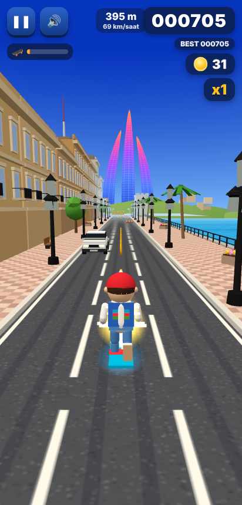

# BAKU RUNNER

Bakı küçələrində keçən, tam offline işləyən 3D endless runner oyunu (Android).



## Hazır APK

`release/BakuRunner-v1.0.0.apk` — telefona köçürüb quraşdırın ("Naməlum mənbələrdən quraşdırma" icazəsi lazım ola bilər).
Release APK debug açarı ilə imzalanıb (test üçün). Play Store üçün öz açarınızla imzalayın (aşağıya baxın).

## Oyun

| Hərəkət | İdarəetmə |
|---|---|
| Sola / sağa sürüşdür | Zolaq dəyiş (3 zolaq) |
| Yuxarı sürüşdür | Tullan (konus, baryer üzərindən) |
| Aşağı sürüşdür | Sürüş ("TƏMİR" tirinin altından); havada olarkən — sürətli eniş |

* Personaj avtomatik qaçır, sürət zamanla artır (54 → 144 km/saat).
* Maneələr: BakuBus avtobusları (dayanan və hərəkət edən), sarı taksi və bənövşəyi London taksisi, minik avtomobilləri, konuslar, yol təmiri baryerləri, təmir hasarları, üstdən keçən təmir tirləri. Qəfil zolaq dəyişən maşınlar qırmızı ⚠ işarəsi və siqnal səsi ilə xəbər verir.
* Maneə generatoru hər sırada **ən azı bir keçilə bilən zolaq** saxlayır və oyunçunun ora vaxtında çata biləcəyini yoxlayır.
* Önə toqquşma — oyun bitir. Yandan toqquşma — geri itələnir; 4 saniyə ərzində ikinci yan zərbə oyunu bitirir.
* Coin-lər (səs + parıltı animasiyası), Maqnit və x2 power-up-ları, Kaykay (bir toqquşmadan qoruyur).
* 6 rayon növbə ilə dəyişir (~520 m): Dənizkənarı Bulvar, İçərişəhər, Neftçilər Prospekti, BakuBus Küçəsi, Gecə Bakı, Bayraq Meydanı · Gün batımı. Arxa planda Alov Qüllələri (gecə alov animasiyası), Televiziya qülləsi, Qız qalası, Bayraq meydanı, təpələr.
* 6 personaj (Rəşad, Elvin, Leyla, Aysel, Babək, Kamran) — Azərbaycan temalı geyimlər: bayraq jileti, buta, xalça naxışı, kəlağayı, papaq və çuxa.
* Menyular: PLAY, CHARACTERS, GARAGE (maqnit/x2 təkmilləşdirmə, kaykay), SETTINGS (səs, musiqi, vibrasiya, qrafika, FPS, sıfırlama), BEST SCORE, COINS. HUD: score, best score, coin, x1/x2, məsafə, sürət, pause, səs. Pause oyunu tam dondurur, davam edəndə 3-2-1 geri sayım.

## Offline

* `AndroidManifest.xml`-də **INTERNET icazəsi yoxdur** (yalnız `VIBRATE`).
* Login, server, Firebase, reklam və ya analitika SDK-sı yoxdur — Gradle-də heç bir asılılıq yoxdur.
* Bütün qrafika, teksturalar və səslər kodla yaradılır və APK-nın içindədir (`assets/game`).
* WebView şəbəkə yükləmələrini bloklayır (`setBlockNetworkLoads(true)`); APK-dan kənar hər sorğu rədd edilir.
* Coin, rekord, personajlar və ayarlar telefonda `SharedPreferences`-də saxlanılır.

## Layihə strukturu

```
web/                     Oyunun mənbə kodu (JavaScript + three.js)
  src/config.js          Sürət, zolaqlar, tullanma və s. sabitlər
  src/game/Game.js       Oyun dövrü, vəziyyətlər, xal, power-up, kamera
  src/game/Player.js     Personaj modeli və animasiyaları
  src/game/characters.js Personaj siyahısı (yenisini buraya əlavə edin)
  src/game/themes.js     Şəhər rayonları (yeni şəhər/xəritə buraya)
  src/game/obstacleTypes.js Maneə kataloqu (yeni avtomobil buraya)
  src/game/prefabs.js    Prosedur 3D modellər: binalar, maşınlar, maneələr
  src/game/World.js      Səma, işıqlandırma, skyline, yol və dekorasiya
  src/game/Spawner.js    Ədalətli maneə/coin generatoru və toqquşma
  src/ui.js, public/     Menyular və HUD
android/                 Android Studio / Gradle layihəsi (Java, WebView)
```

### Genişləndirmə

* **Yeni avtomobil:** `prefabs.js`-də `registerPrefab('car_x', ...)`, sonra `obstacleTypes.js`-də `prefabs` siyahısına əlavə edin.
* **Yeni personaj:** `characters.js`-ə yeni obyekt (rənglər, papaq tipi, jilet naxışı, qiymət).
* **Yeni rayon / şəhər:** `themes.js`-ə yeni element (bina tipləri, yol, işıqlandırma, maneə çəkiləri, skyline).

## Build

Tələblər: Node.js 18+, JDK 17+, Android SDK (platform 34, build-tools 34).

```bash
# 1) Oyunu yığ (nəticə android/app/src/main/assets/game/ qovluğuna yazılır, artıq commit olunub)
cd web && npm install && npm run build

# 2) APK
cd ../android
./gradlew assembleDebug      # app/build/outputs/apk/debug/app-debug.apk
./gradlew assembleRelease    # app/build/outputs/apk/release/app-release.apk
```

Və ya `android/` qovluğunu Android Studio-da açıb **Build → Build APK(s)**.

Brauzerdə test: `android/app/src/main/assets/game/index.html` faylını açın (klaviatura: oxlar / WASD / Space, P — pauza).

GitHub Actions (`.github/workflows/android.yml`) hər push-da APK yığır və artifact kimi yükləyir.

### Release imzası

`android/keystore.properties` yaradın:

```
storeFile=baku-runner.jks
storePassword=...
keyAlias=bakurunner
keyPassword=...
```

Açar yaratmaq: `keytool -genkey -v -keystore android/baku-runner.jks -keyalg RSA -keysize 2048 -validity 10000 -alias bakurunner`.
Bu fayllar `.gitignore`-dadır.
