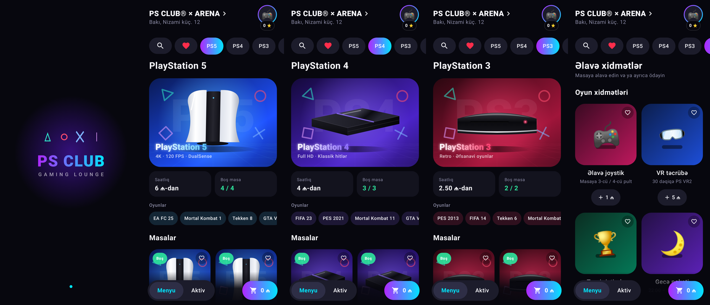

# PS Club — PlayStation Club Android tətbiqi

Offline işləyən, 3D neon dizaynlı PlayStation Club tətbiqi (Kotlin + Jetpack Compose).

**Hazır APK:** [`release/PSClub.apk`](release/PSClub.apk) — telefona köçürüb quraşdırın (Android 8.0+).



## Funksiyalar
- **PS5 / PS4 / PS3 masaları** — hər konsol üçün ayrıca 3D poster (barmaqla fırlatmaq olur), masa seçimi, müddət (30 dəq – 5 saat və ya açıq vaxt), canlı taymer, qiymət hesablanması, vaxt artırma, çek.
- **Əlavə xidmətlər** — joystik, VR, turnir, içki və qəlyanaltılar; səbət, ayrıca ödəniş və ya aktiv masanın hesabına əlavə.
- **Telefon təmiri** — xidmət növləri, qiymətlər, müddət, sifariş forması, sifariş statusları.
- **Admin panel** (PIN: `1234`, Ayarlardan dəyişin) — konsol/masa qiymətləri, masalar, xidmətlər, təmir qiymətləri, sifarişlər, gəlir hesabatı, oyun siyahıları, klub məlumatları, bonus sistemi.
- Bonus xallar, seçilmişlər (♥), axtarış, Dark/Light mode, animasiyalar.
- **İnternet tələb etmir** — tətbiqdə INTERNET icazəsi yoxdur; bütün məlumatlar telefonun yaddaşında saxlanılır.

## Qurmaq
```
./gradlew assembleRelease   # app/build/outputs/apk/release/app-release.apk
```
Android SDK (platform 34) lazımdır; yolu `local.properties`-də `sdk.dir=` ilə göstərin.
